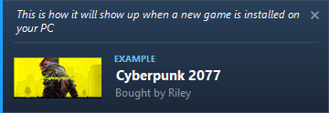
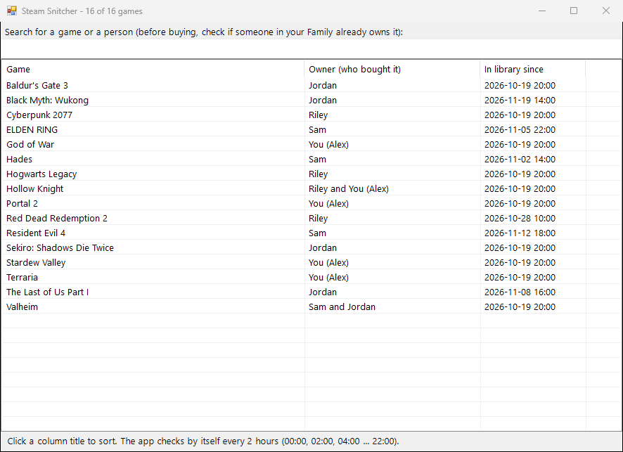

# Steam Snitcher

> [!IMPORTANT]
> **Version 2.0 is 100% local: no sign-in, no connection to Steam, no internet.** It only reads files that the Steam client already keeps on your PC.
>
> Why: version 1.0 signed in to Steam with a QR code that presented the app as the *Steam mobile app*. Steam's security system flagged it as an unexpected device and temporarily restricted the author's account (*"This account may have been accessed by someone else"*). It was **not a ban**, but Steam signed out every session and reset the password. Another open-source app, **Lumen**, hit exactly the same problem with the same kind of sign-in ([their incident report](https://github.com/axelprz/lumen/pull/35), [their fix](https://github.com/axelprz/lumen/pull/38)). See the [version history](#version-history).
>
> **If you used 1.0:** run 2.0 once (it deletes the old connection), remove **"PC - Steam Snitcher"** under **Steam → Account details → Authorized devices**, and contact [Steam Support](https://help.steampowered.com) if your account shows the same alert.

**A small Windows app that rats out your Steam Family.** When a game from your Steam Family shows up on your PC, Steam Snitcher tells you **which game it is and who bought it**, in a Steam-style notification that stays until you close it.

<p align="center"></p>

- Free and open source (MIT)
- One small `.exe`, nothing else to install
- **Never signs in, never connects to anything**: Steam doesn't even know it exists
- Runs quietly next to the clock and starts with Windows
- Speaks Portuguese on Portuguese Windows and English everywhere else

---

## The problem it solves

[Steam Families](https://store.steampowered.com/families) let up to 6 people share their game libraries. That's great, but:

- **Nobody tells you whose game it is.** Steam shows the owner deep inside each game's page, but there is no simple "who owns what" list.
- **You end up paying twice.** You buy a game that someone in the family already owns and you could have played for free.
- **Games appear without anyone saying anything.** Someone shares a game, you install it, and nobody knows who paid for it.

Steam Snitcher keeps a list of the games on your PC with the owner of each one, and snitches when a new one shows up.

## What it does

| | |
|---|---|
| **New game alerts** | Every 2 hours, on the clock (00:00, 02:00, 04:00 … 22:00) and once when the PC starts, it compares the games on your PC with the last snapshot, title by title. If nothing changed, it does nothing. If a new game appears, a Steam-style notification shows up in the bottom-right corner with the game's capsule art, its name and who bought it. |
| **Notifications stay put** | They don't fade away after 5 seconds. They stay until you click the **✕**, so you never miss one, even if you were away from the PC. They also never steal focus from a game you're playing. |
| **Who-owns-what list** | A searchable list of the games on your PC and who owns each one. |
| **Floods handled** | If many games appear at once, you get 4 notifications plus one "+N more new games" card instead of a wall of popups. |

## Screenshots

All screenshots use the built-in demo mode, so the names (Alex, Sam, Jordan, Riley) are made up.

### Notifications

A new game on your PC:


Right after installation it shows one example notification with a real game from your PC, so you know what to expect:



On a Portuguese Windows, everything is in Portuguese:


### The list

Double-click the tray icon (or open **Steam Snitcher** from the Start menu) to see every game and who bought it. Click a column title to sort by name, owner or the date the game showed up. Type in the box to search by game or by person.




### Tray menu

Right-click the icon next to the clock:


- **See games and owners**: opens the list.
- **Check now**: checks right away instead of waiting for the next even hour.
- **Exit**: closes Steam Snitcher until the next time Windows starts.

---

## Install

1. Build `SteamSnitcher.exe` with [`build.cmd`](#build-from-source), or download it from the [Releases](https://github.com/Suaviiiii/steam-snitcher/releases) page if there is one.
2. Double-click it. The app isn't code-signed, so Windows SmartScreen may say *"Windows protected your PC"*. Click **More info → Run anyway**.
3. The file installs itself. It copies itself to `%LOCALAPPDATA%\Programs\SteamSnitcher`, adds a Start menu shortcut and sets itself to start with Windows. It doesn't need administrator rights.
4. That's it. There's nothing to connect. It reads the games on your PC, saves them as the starting snapshot, opens the list and shows you the example notification.

## How it works

Steam Snitcher **only reads files**. It has no network code at all: no Steam Web API, no website, no sign-in, no image downloads, no telemetry. You can check: the source is one file, [`src/SteamSnitcher.cs`](src/SteamSnitcher.cs).

| What it needs | Where the Steam client already keeps it |
|---|---|
| Where Steam is installed | Registry: `HKCU\Software\Valve\Steam` → `SteamPath` |
| Which of your drives have Steam games | `steamapps\libraryfolders.vdf` |
| The games on your PC and **who owns each one** | One `steamapps\appmanifest_<appid>.acf` per game. Its `LastOwner` field is the account whose license Steam uses for that game. For a Steam Family game, that's the person who bought it. |
| Which account is yours | Registry `HKCU\Software\Valve\Steam\ActiveProcess` → `ActiveUser` (while Steam is open), otherwise the most recent account in `config\loginusers.vdf` |
| The names of the people in your family | The friend cache the Steam client keeps in `userdata\<you>\config\localconfig.vdf` |
| The capsule art for the notification | The images the Steam library already downloaded to `appcache\librarycache\<appid>` |

Then:

- **First run:** the games on your PC become the snapshot. You get no "new game" alerts for games that were already there, just the example notification.
- **Every check:** every game that isn't in the snapshot is new and gets a notification. A game you uninstall leaves the snapshot quietly; if you install it again, you get notified again.
- **Schedule:** a timer checks the PC clock every 30 seconds and runs at each even hour. If the PC was asleep during a slot, it checks as soon as it wakes up. If the PC was off, it checks one minute after Windows starts.

## Files

| What | Where |
|---|---|
| The program | `%LOCALAPPDATA%\Programs\SteamSnitcher\SteamSnitcher.exe` |
| Snapshot of the games on your PC | `%LOCALAPPDATA%\SteamSnitcher\instalados.txt` |
| Log | `%LOCALAPPDATA%\SteamSnitcher\registro.txt` |
| Start with Windows | `HKCU\Software\Microsoft\Windows\CurrentVersion\Run` → `SteamSnitcher` |

The file names are in Portuguese because that's where the app started.

### Uninstall

1. Right-click the tray icon → **Exit**.
2. **Task Manager → Startup apps → SteamSnitcher → Disable** (or delete the `SteamSnitcher` value from the registry key above).
3. Delete `%LOCALAPPDATA%\Programs\SteamSnitcher`, `%LOCALAPPDATA%\SteamSnitcher` and the **Steam Snitcher** shortcut in the Start menu.

## Language

The interface follows the Windows display language: Portuguese if Windows is in Portuguese, English for any other language. To force one, set the environment variable `STEAMSNITCHER_LANG` to `pt` or `en`.

## Demo mode

```
SteamSnitcher.exe --demo
```

This opens the list and the notifications with made-up data, so you can see the app without changing anything. It doesn't install anything or touch your data. The screenshots above come from it. `SteamSnitcher.exe --demo elden` opens the list with a search already typed in.

## Build from source

You don't need Visual Studio or any SDK. The C# compiler that ships with every Windows 10/11 (.NET Framework 4.x) is enough:

```
build.cmd
```

This produces `SteamSnitcher.exe` next to the script. All the code is in one file, [`src/SteamSnitcher.cs`](src/SteamSnitcher.cs), with no external libraries. The comments in the code are in Portuguese.

## Limitations

The price of being 100% local:

- **It only sees games installed on your PC.** If someone in the family buys a game and you don't install it, the app doesn't know. That information only exists on Steam's servers, and the app deliberately never talks to them.
- **No wishlist alerts.** Your wishlist isn't stored on your PC.
- **The owner is the license Steam uses.** If several people own the same game (you included), the list shows the account Steam picked for that game on your PC.
- **Windows only.**
- **It's not real time.** It checks every 2 hours, so a game installed at 14:05 shows up at 16:00, or right away with **Check now**.
- It reads files in the Steam client's own format. If Valve changes those files, the app may stop finding games until it's updated. It logs the error and never touches the files.

## Version history

**2.0** (19 November 2026): 100% local
- Removed every network connection: no sign-in, no Steam Web API, no website, no image downloads.
- Reads the games on your PC, their owners (`LastOwner` in each `appmanifest`), family names and capsule art from the Steam client's own files.
- On first start it deletes the 1.0 connection and reminds you to remove "PC - Steam Snitcher" from your authorized devices.
- Lost compared to 1.0: alerts for family games you haven't installed, and wishlist alerts.

**1.1** (never released)
- Tried signing in on Steam's own website in an embedded browser (WebView2) instead of the QR code, the way Lumen did after the same incident. It was dropped before release in favor of 2.0, which doesn't sign in at all.

**1.0** (19 November 2026, withdrawn the same day)
- Signed in with a QR code through `IAuthenticationService`, presenting itself as the Steam mobile app, and read the whole family library from the Steam Web API (`IFamilyGroupsService/GetSharedLibraryApps`), including the wishlist.
- At the exact minute it connected, Steam flagged the sign-in as an unexpected device. Later that day Steam's automatic security system signed out every session on the account and reset the password, sending a new one by email. It was not a ban. The download and the release were removed.
- The same thing had already happened to the open-source app Lumen ([incident](https://github.com/axelprz/lumen/pull/35), [fix](https://github.com/axelprz/lumen/pull/38)).

## Is this allowed? Safety, privacy and disclaimer

- **It only reads files on your own PC** that the Steam client wrote there. It doesn't modify them, doesn't inject anything into Steam, doesn't touch game files and doesn't automate anything.
- **It never connects to Steam or to the internet**, so it can't trigger Steam's sign-in security checks, and nothing about your account or your family leaves your PC.
- **Everything it stores** (the snapshot and the log) stays in `%LOCALAPPDATA%\SteamSnitcher`. Nothing is uploaded or synced anywhere.
- **Privacy within the family.** The app tells you who bought what. Your family members can already see this in Steam, but the app makes it much more visible. Use it as a convenience, not to police anyone.

**Disclaimer:** Steam Snitcher is a fan-made tool. It isn't affiliated with, endorsed by or sponsored by Valve. Steam and the Steam logo are trademarks of Valve Corporation. Game capsule images are read from the Steam client's local cache at runtime and aren't included in this repository, except in the screenshots. The software is provided "as is", without warranty (see the [license](LICENSE)).

## License

[MIT](LICENSE): free to use, change and share.
