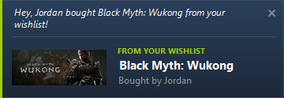
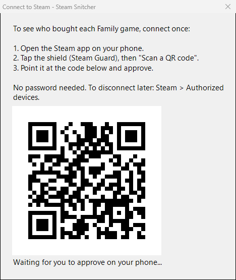
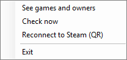

# Steam Snitcher

**A tiny Windows app that rats out your Steam Family.** When a new game lands in your Steam library, Steam Snitcher tells you **which game it is and who bought it**. It also calls out the best case: *"Hey, Jordan bought Black Myth: Wukong from your wishlist!"*

<p align="center"></p>

- Free and open source (MIT)
- One ~50 KB `.exe`, nothing else to install
- No password, ever: you connect once by scanning a QR code with the Steam mobile app
- Runs quietly next to the clock and starts with Windows
- Speaks Portuguese on Portuguese Windows and English everywhere else

> **[⬇ Download SteamSnitcher.exe](https://github.com/Suaviiiii/steam-snitcher/releases/latest/download/SteamSnitcher.exe)**, double-click it, scan the QR code, done.

---

## The problem it solves

[Steam Families](https://store.steampowered.com/families) let up to 6 people share their game libraries. That's great, but:

- **Nobody tells you when a new game shows up.** A family member buys something and it quietly appears somewhere in a library of hundreds of games. You find out weeks later, if you ever do.
- **You can't easily see who bought what.** Steam shows the owner deep inside each game's page, but there is no simple "who owns what" list.
- **You end up paying twice.** You buy a game that someone in the family already owns and you could have played for free.
- **Wishlist games slip by.** Your cousin buys the exact game on your wishlist and you keep waiting for a sale that you don't need anymore.

Steam Snitcher keeps an eye on the whole shared library for you and snitches the moment something changes.

## What it does

| | |
|---|---|
| **New game alerts** | Every 2 hours, on the clock (00:00, 02:00, 04:00 … 22:00) and once when the PC starts, it compares the whole library with the last snapshot, title by title. If nothing changed, it does nothing. If a new game appears, a Steam-style notification shows up in the bottom-right corner with the game's capsule art, its name and who bought it. |
| **Wishlist alerts** | If the new game was on **your** wishlist and someone else bought it, the notification turns green: *"Hey, Sam bought Hades from your wishlist!"* |
| **Notifications stay put** | They don't fade away after 5 seconds. They stay until you click the **✕**, so you never miss one, even if you were away from the PC. They also never steal focus from a game you're playing. |
| **Who-owns-what list** | A searchable list of every game in your library and its owner(s). Type a name before buying anything and see if someone already has it. |
| **Floods handled** | If a new member joins and 150 games appear at once, you get 4 notifications plus one "+146 more new games" card instead of a wall of popups. |

## Screenshots

All screenshots use the built-in demo mode, so the names (Alex, Sam, Jordan, Riley) are made up.

### Notifications

| A game from your wishlist was bought | A new game in the library |
|---|---|
|  |  |

Right after installation it shows one example notification with a real game from your library, so you know what to expect:


On a Portuguese Windows, everything is in Portuguese:


### The library list

Double-click the tray icon (or open **Steam Snitcher** from the Start menu) to see every game and who bought it. Click a column title to sort by name, owner or the date the game showed up.


**Before you buy anything**, type its name. If it's there, someone in the family already owns it:


### Connecting to Steam (once)



### Tray menu

Right-click the icon next to the clock:



- **See games and owners**: opens the list.
- **Check now**: checks right away instead of waiting for the next even hour.
- **Reconnect to Steam (QR)**: shows a new QR code, if you ever disconnect the app.
- **Exit**: closes Steam Snitcher until the next time Windows starts.

---

## Install

1. Download **[SteamSnitcher.exe](https://github.com/Suaviiiii/steam-snitcher/releases/latest/download/SteamSnitcher.exe)** (also in the root of this repository).
2. Double-click it. The app isn't code-signed, so Windows SmartScreen may say *"Windows protected your PC"*. Click **More info → Run anyway**. If you'd rather not trust a binary, [build it yourself](#build-from-source): it takes one command.
3. The file installs itself. It copies itself to `%LOCALAPPDATA%\Programs\SteamSnitcher`, adds a Start menu shortcut and sets itself to start with Windows. It doesn't need administrator rights.
4. A window with a QR code opens. On your phone:
   1. Open the **Steam** app.
   2. Tap the **shield** (Steam Guard) at the bottom, then **Scan a QR code**.
   3. Point the camera at the code on your PC and approve.

   > If the Steam app says *"This app needs access to the camera"*, allow it: long-press the Steam icon → **App info** → **Permissions** → **Camera** → **Allow only while using the app**. Then reopen the Steam app.
5. That's it. Steam Snitcher reads your whole library, saves it as the starting snapshot, opens the list and shows you the example notification.

You don't need to open anything after that. It starts with Windows and works in the background.

## How it works

Steam Snitcher only talks to Steam's own servers. There's no server of mine in the middle, no account to create and no telemetry.

### 1. Connecting without a password

Steam supports the same "scan a QR code to sign in" flow that the Steam desktop client and the Steam website use. Steam Snitcher:

1. Asks Steam to start a QR sign-in session (`IAuthenticationService/BeginAuthSessionViaQR`).
2. Draws the QR code itself (a small QR encoder is built into the app; nothing is sent to third-party QR services).
3. Waits for you to approve on your phone (`IAuthenticationService/PollAuthSessionStatus`).
4. Receives a **refresh token** and stores it on disk **encrypted with Windows DPAPI**, which means only your Windows user account on this PC can decrypt it.
5. Before every check, it trades the refresh token for a short-lived access token (`IAuthenticationService/GenerateAccessTokenForApp`). Steam renews the refresh token on its own, so the connection lasts for months. If it ever expires or you revoke it, the app asks for a new QR code.

The app shows up in your Steam account as an authorized device named **"PC - Steam Snitcher"**. You can remove it at any time in **Steam → Account details → Authorized devices**.

### 2. Reading the shared library and who bought each game

Each check asks Steam's Family API for the whole shared library:

- `IFamilyGroupsService/GetFamilyGroupForUser` finds your family group.
- `IFamilyGroupsService/GetSharedLibraryApps` returns every app in the family library, with its name and **`owner_steamids`**, the account(s) that actually bought it. This is the only reliable source for the owner. The Steam client's local files on your PC know who is in the family, but not who bought each game.

It keeps your own games plus the games other members are actually sharing with you. Games a member has excluded from sharing are skipped.

**Owner names** come from the friend cache that the Steam desktop client already keeps on your PC (`userdata\<you>\config\localconfig.vdf`), so they match the names you see in Steam. If a name isn't there, the app shows the account number instead.

### 3. The wishlist

On each check it also reads your wishlist (`IWishlistService/GetWishlist`) and remembers it. When a new game appears and it was on your wishlist, either now or at the previous check (Steam may remove it from the wishlist once it's in the library), and you are not the buyer, you get the green wishlist notification.

### 4. Comparing and notifying

- The snapshot is a plain text file (tab-separated): app id, game, owner(s), date first seen.
- **First run:** the whole library becomes the snapshot. You get no "new game" alerts for games that were already there, just the example notification.
- **Every check:** every app id that isn't in the snapshot is a new game. The app downloads the game's capsule art from Steam's CDN and shows the notification. Games that left the library (for example, when a member leaves the family) are removed from the snapshot quietly.
- **Schedule:** a timer checks the PC clock every 30 seconds and runs at each even hour. If the PC was asleep during a slot, it checks as soon as it wakes up. If the PC was off, it checks one minute after Windows starts.
- If the internet or Steam is down, it writes the error to the log and tries again at the next slot. An empty answer from Steam is treated as an error, so a hiccup on Steam's side doesn't wipe the snapshot.

## Files

| What | Where |
|---|---|
| The program | `%LOCALAPPDATA%\Programs\SteamSnitcher\SteamSnitcher.exe` |
| Library snapshot | `%LOCALAPPDATA%\SteamSnitcher\biblioteca.txt` |
| Last wishlist | `%LOCALAPPDATA%\SteamSnitcher\lista_desejos.txt` |
| Steam connection (DPAPI-encrypted) | `%LOCALAPPDATA%\SteamSnitcher\conexao.dat` |
| Log | `%LOCALAPPDATA%\SteamSnitcher\registro.txt` |
| Start with Windows | `HKCU\Software\Microsoft\Windows\CurrentVersion\Run` → `SteamSnitcher` |

The file names are in Portuguese because that's where the app started.

### Uninstall

1. Right-click the tray icon → **Exit**.
2. **Task Manager → Startup apps → SteamSnitcher → Disable** (or delete the `SteamSnitcher` value from the registry key above).
3. Delete `%LOCALAPPDATA%\Programs\SteamSnitcher`, `%LOCALAPPDATA%\SteamSnitcher` and the **Steam Snitcher** shortcut in the Start menu.
4. In **Steam → Account details → Authorized devices**, remove **"PC - Steam Snitcher"**.

## Language

The interface follows the Windows display language: Portuguese if Windows is in Portuguese, English for any other language. Game names come from Steam in the same language. To force one, set the environment variable `STEAMSNITCHER_LANG` to `pt` or `en`.

## Demo mode

```
SteamSnitcher.exe --demo
```

This opens every window and notification with made-up data, so you can see the app without connecting anything. It doesn't install anything or touch your data. The screenshots above come from it. `SteamSnitcher.exe --demo elden` opens the list with a search already typed in.

## Build from source

You don't need Visual Studio or any SDK. The C# compiler that ships with every Windows 10/11 (.NET Framework 4.x) is enough:

```
build.cmd
```

This produces `SteamSnitcher.exe` next to the script. All the code is in one file: [`src/SteamSnitcher.cs`](src/SteamSnitcher.cs). It has no external dependencies; JSON, encryption, HTTP and the QR code all use the .NET Framework or are written in the file. The comments in the code are in Portuguese.

## Limitations

- **Windows only.**
- **You need to be in a Steam Family**, which is the whole point of the app.
- **It's not real time.** It checks every 2 hours, so a game bought at 14:05 shows up at 16:00.
- **It uses Steam's Web API endpoints** that power the Steam client and website. They work today but aren't officially documented for third parties, so Valve could change them. If that happens, the app logs the error and keeps trying, and an update would be needed.
- Owner names depend on the Steam desktop client's local friend cache. If the Steam client isn't installed on the PC, you'll see account numbers instead of names.

## Disclaimer

Steam Snitcher is a fan-made tool. It isn't affiliated with, endorsed by or sponsored by Valve. Steam and the Steam logo are trademarks of Valve Corporation. Game capsule images are loaded from Steam's public CDN at runtime and aren't included in this repository, except in the screenshots.

## License

[MIT](LICENSE): free to use, change and share.
