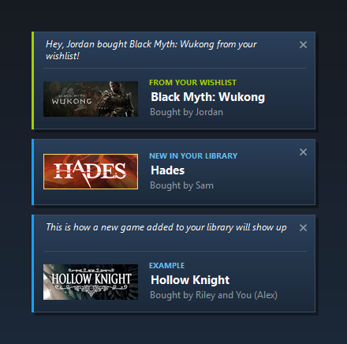
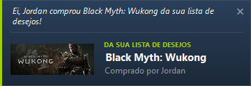
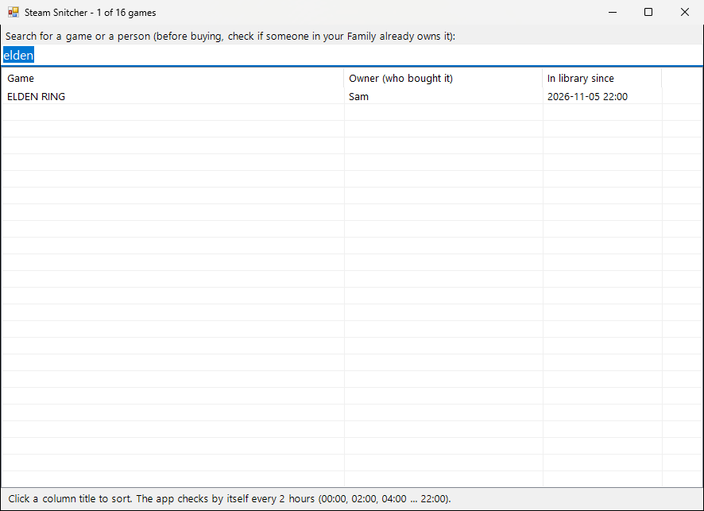
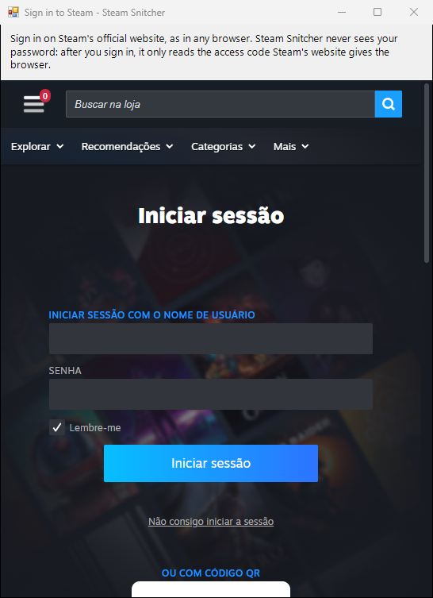

# Steam Snitcher

> [!WARNING]
> **Version 1.0 could get your Steam account temporarily restricted. Version 1.1 removes the cause.**
>
> Version 1.0 connected with a QR code that presented the app to Steam as the *Steam mobile app*, while it was actually running on a PC. Steam's security system saw this as an unexpected device and, the same day, temporarily restricted the author's account with the alert *"This account may have been accessed by someone else"*. It was **not a ban**: Steam limited changes to the account until Steam Support confirms who owns it.
>
> We weren't the only ones. Another open-source app, **Lumen**, hit exactly the same problem with the same kind of QR sign-in a few weeks earlier: [their incident report](https://github.com/axelprz/lumen/pull/35) and [their fix](https://github.com/axelprz/lumen/pull/38).
>
> **Version 1.1 no longer has the QR sign-in.** You sign in on Steam's own website, inside the app, like in any browser, and the app never pretends to be another device. See the [version history](#version-history) for details.
>
> **Downloads stay paused** until 1.1 has been verified on a real account.
>
> **If you used 1.0:** close the app, delete `%LOCALAPPDATA%\SteamSnitcher\conexao.dat` (version 1.1 does this for you), remove **"PC - Steam Snitcher"** under **Steam → Account details → Authorized devices**, and contact [Steam Support](https://help.steampowered.com) if your account shows the same alert.

**A small Windows app that rats out your Steam Family.** When a new game lands in your Steam library, Steam Snitcher tells you **which game it is and who bought it**. It also calls out the best case: *"Hey, Jordan bought Black Myth: Wukong from your wishlist!"*

<p align="center"></p>

- Free and open source (MIT)
- A single `.exe` of about 1 MB, nothing else to install on Windows 11
- The app never sees your password: you sign in on Steam's own website
- Runs quietly next to the clock and starts with Windows
- Speaks Portuguese on Portuguese Windows and English everywhere else

---

## The problem it solves

[Steam Families](https://store.steampowered.com/families) let up to 6 people share their game libraries. That's great, but:

- **Nobody tells you when a new game shows up.** A family member buys something and it quietly appears somewhere in a library of hundreds of games. You find out weeks later, if you ever do.
- **You can't easily see who bought what.** Steam shows the owner deep inside each game's page, but there is no simple "who owns what" list.
- **You end up paying twice.** You buy a game that someone in the family already owns and you could have played for free.
- **Wishlist games slip by.** Your cousin buys the exact game on your wishlist and you keep waiting for a sale that you don't need anymore.

Steam Snitcher keeps an eye on the whole shared library for you and snitches the moment something changes.

## What it does

| | |
|---|---|
| **New game alerts** | Every 2 hours, on the clock (00:00, 02:00, 04:00 … 22:00) and once when the PC starts, it compares the whole library with the last snapshot, title by title. If nothing changed, it does nothing. If a new game appears, a Steam-style notification shows up in the bottom-right corner with the game's capsule art, its name and who bought it. |
| **Wishlist alerts** | If the new game was on **your** wishlist and someone else bought it, the notification turns green: *"Hey, Sam bought Hades from your wishlist!"* |
| **Notifications stay put** | They don't fade away after 5 seconds. They stay until you click the **✕**, so you never miss one, even if you were away from the PC. They also never steal focus from a game you're playing. |
| **Who-owns-what list** | A searchable list of every game in your library and its owner(s). Type a name before buying anything and see if someone already has it. |
| **Floods handled** | If a new member joins and 150 games appear at once, you get 4 notifications plus one "+146 more new games" card instead of a wall of popups. |

## Screenshots

All screenshots use the built-in demo mode, so the names (Alex, Sam, Jordan, Riley) are made up.

### Notifications

| A game from your wishlist was bought | A new game in the library |
|---|---|
|  |  |

Right after installation it shows one example notification with a real game from your library, so you know what to expect:


On a Portuguese Windows, everything is in Portuguese:



### The library list

Double-click the tray icon (or open **Steam Snitcher** from the Start menu) to see every game and who bought it. Click a column title to sort by name, owner or the date the game showed up.


**Before you buy anything**, type its name. If it's there, someone in the family already owns it:



### Signing in to Steam (once)

The sign-in window shows Steam's real website (`store.steampowered.com`), in your Steam language. You sign in there exactly as in your browser: with your username and password on Steam's page, or with the QR code that Steam's own page offers.



### Tray menu

Right-click the icon next to the clock:


- **See games and owners**: opens the list.
- **Check now**: checks right away instead of waiting for the next even hour.
- **Sign in to Steam again**: opens the Steam sign-in window, if Steam ever logs the app out.
- **Disconnect from Steam**: deletes the app's browser data, including its Steam cookies, and stops checking.
- **Exit**: closes Steam Snitcher until the next time Windows starts.

---

## Install

1. *(Downloads are paused, see the warning at the top.)* For now, build `SteamSnitcher.exe` yourself with [`build.cmd`](#build-from-source).
2. Double-click it. The app isn't code-signed, so Windows SmartScreen may say *"Windows protected your PC"*. Click **More info → Run anyway**.
3. The file installs itself. It copies itself to `%LOCALAPPDATA%\Programs\SteamSnitcher`, adds a Start menu shortcut and sets itself to start with Windows. It doesn't need administrator rights.
4. A window opens with Steam's sign-in page. Sign in as you would in any browser. Steam Guard may ask you to confirm, as usual.
5. That's it. Steam Snitcher reads your whole library, saves it as the starting snapshot, opens the list and shows you the example notification.

You don't need to open anything after that. It starts with Windows and works in the background.

## How it works

Steam Snitcher only talks to Steam's own servers. There's no server of mine in the middle, no account to create and no telemetry.

### 1. Signing in without the app ever seeing your password

- The app opens Steam's sign-in page (`store.steampowered.com/login`) in a window that uses **WebView2**, Microsoft's browser component (the same engine as Edge). The window has its own private browser profile in `%LOCALAPPDATA%\SteamSnitcher\navegador`.
- You sign in on Steam's page. **The app never reads or touches the sign-in page**, so it never sees your password or your Steam Guard codes.
- Once you're on the store, the app opens `store.steampowered.com/pointssummary/ajaxgetasyncconfig` in the same browser and reads the `webapi_token` that Steam's website gives every signed-in browser. That's the only thing it reads.
- The token lasts about a day and is kept **only in memory**; it's never written to disk. When it's about to expire, the app loads the Steam store in a hidden window with the same browser profile. That's exactly what happens when you reopen a browser where you're already signed in: **no new sign-in and no new device**. The hidden window never takes focus, so it won't interrupt a game.
- The window is locked down: only `https` Steam sites can open, and pop-ups, developer tools, the right-click menu, autofill and password saving are disabled.
- If Steam ever logs the app out, it asks you to sign in again instead of trying anything on its own.

This is the same approach Lumen switched to after the same incident, modeled on how Playnite reads Steam libraries.

### 2. Reading the shared library and who bought each game

Each check asks Steam's Family API for the whole shared library:

- `IFamilyGroupsService/GetFamilyGroupForUser` finds your family group.
- `IFamilyGroupsService/GetSharedLibraryApps` returns every app in the family library, with its name and **`owner_steamids`**, the account(s) that actually bought it. This is the only reliable source for the owner. The Steam client's local files on your PC know who is in the family, but not who bought each game, and a regular Steam Web API key can't read family data.

It keeps your own games plus the games other members are actually sharing with you. Games a member has excluded from sharing are skipped.

**Owner names** come from the friend cache that the Steam desktop client already keeps on your PC (`userdata\<you>\config\localconfig.vdf`), so they match the names you see in Steam. If a name isn't there, the app shows the account number instead.

### 3. The wishlist

On each check it also reads your wishlist (`IWishlistService/GetWishlist`) and remembers it. When a new game appears and it was on your wishlist, either now or at the previous check (Steam may remove it from the wishlist once it's in the library), and you are not the buyer, you get the green wishlist notification.

### 4. Comparing and notifying

- The snapshot is a plain text file (tab-separated): app id, game, owner(s), date first seen.
- **First run:** the whole library becomes the snapshot. You get no "new game" alerts for games that were already there, just the example notification.
- **Every check:** every app id that isn't in the snapshot is a new game. The app downloads the game's capsule art from Steam's CDN and shows the notification. Games that left the library (for example, when a member leaves the family) are removed from the snapshot quietly.
- **Schedule:** a timer checks the PC clock every 30 seconds and runs at each even hour. If the PC was asleep during a slot, it checks as soon as it wakes up. If the PC was off, it checks one minute after Windows starts.
- If the internet or Steam is down, it writes the error to the log and tries again at the next slot. An empty answer from Steam is treated as an error, so a hiccup on Steam's side doesn't wipe the snapshot.

## Files

| What | Where |
|---|---|
| The program | `%LOCALAPPDATA%\Programs\SteamSnitcher\SteamSnitcher.exe` |
| Library snapshot | `%LOCALAPPDATA%\SteamSnitcher\biblioteca.txt` |
| Last wishlist | `%LOCALAPPDATA%\SteamSnitcher\lista_desejos.txt` |
| The app's browser profile (Steam cookies) | `%LOCALAPPDATA%\SteamSnitcher\navegador\` |
| When you signed in | `%LOCALAPPDATA%\SteamSnitcher\conectado.txt` |
| WebView2 libraries (extracted from the .exe) | `%LOCALAPPDATA%\SteamSnitcher\lib\` |
| Log | `%LOCALAPPDATA%\SteamSnitcher\registro.txt` |
| Start with Windows | `HKCU\Software\Microsoft\Windows\CurrentVersion\Run` → `SteamSnitcher` |

The file names are in Portuguese because that's where the app started.

### Uninstall

1. Right-click the tray icon → **Disconnect from Steam**, then **Exit**.
2. **Task Manager → Startup apps → SteamSnitcher → Disable** (or delete the `SteamSnitcher` value from the registry key above).
3. Delete `%LOCALAPPDATA%\Programs\SteamSnitcher`, `%LOCALAPPDATA%\SteamSnitcher` and the **Steam Snitcher** shortcut in the Start menu.
4. If you ever used version 1.0, remove **"PC - Steam Snitcher"** under **Steam → Account details → Authorized devices**.

## Language

The interface follows the Windows display language: Portuguese if Windows is in Portuguese, English for any other language. Game names come from Steam in the same language. To force one, set the environment variable `STEAMSNITCHER_LANG` to `pt` or `en`.

## Demo mode

```
SteamSnitcher.exe --demo
```

This opens every window and notification with made-up data, so you can see the app without connecting anything. The sign-in window opens Steam's real page in an empty, throwaway browser profile, so it never shows your account and nothing gets read. Demo mode doesn't install anything or touch your data. The screenshots above come from it. `SteamSnitcher.exe --demo elden` opens the list with a search already typed in.

## Build from source

You don't need Visual Studio or any SDK. The C# compiler that ships with every Windows 10/11 (.NET Framework 4.x) is enough:

```
build.cmd
```

This produces `SteamSnitcher.exe` (64-bit) next to the script. All the app's code is in one file: [`src/SteamSnitcher.cs`](src/SteamSnitcher.cs). The comments in the code are in Portuguese.

The only outside code is Microsoft's WebView2 SDK, in [`lib/`](lib): `Microsoft.Web.WebView2.Core.dll`, `Microsoft.Web.WebView2.WinForms.dll` and `WebView2Loader.dll`, from the official [Microsoft.Web.WebView2](https://www.nuget.org/packages/Microsoft.Web.WebView2) NuGet package (version 1.0.4314.35), all signed by Microsoft. The build embeds them in the `.exe`, which extracts them on first run.

## Limitations

- **Windows only, 64-bit.**
- **It needs the Microsoft Edge WebView2 Runtime.** It's built into Windows 11. On Windows 10, if the sign-in window says it's missing, install it from [Microsoft](https://developer.microsoft.com/microsoft-edge/webview2/).
- **You need to be in a Steam Family**, which is the whole point of the app.
- **It's not real time.** It checks every 2 hours, so a game bought at 14:05 shows up at 16:00.
- **No sign-in can be guaranteed never to trip Steam's security checks.** Steam decides what looks unusual. Version 1.1 uses a normal sign-in on Steam's website, the most ordinary option there is, but signing in on a browser Steam hasn't seen before can still lead to a security email or check from Steam.
- **It uses Steam's Web API endpoints** that power the Steam client and website. They work today but aren't officially documented for third parties, so Valve could change them. If that happens, the app logs the error and keeps trying, and an update would be needed.
- Owner names depend on the Steam desktop client's local friend cache. If the Steam client isn't installed on the PC, you'll see account numbers instead of names.

## Version history

**1.1** (in testing, not released yet)
- **Removed the QR sign-in** that presented the app as the Steam mobile app, the cause of the account restriction in 1.0.
- You now sign in on Steam's own website in a WebView2 window. The app reads only the token Steam's website gives the browser, keeps it in memory only, and renews it by reloading the store with the same browser profile, so there's no new sign-in and no new device.
- On first start it deletes the 1.0 connection and reminds you to remove "PC - Steam Snitcher" from your authorized devices.
- New **Disconnect from Steam** menu item.

**1.0** (19 November 2026, withdrawn the same day)
- First release.
- Signed in with a QR code through `IAuthenticationService`, presenting itself as the Steam mobile app. The same day, at the exact minute it connected, Steam flagged the sign-in and temporarily restricted the author's account as possibly accessed by someone else. It was not a ban; Steam Support restores access after confirming ownership. The download was removed and the release deleted.
- The same issue had already happened to the open-source app Lumen ([incident](https://github.com/axelprz/lumen/pull/35), [fix](https://github.com/axelprz/lumen/pull/38)).

## Is this allowed? Safety, privacy and disclaimer

**What the app does and doesn't do**

- **It only reads what Steam already shows you.** Your family's shared library, who owns each game and your own wishlist are all visible to you in the Steam client and on the Steam website. Steam Snitcher asks Steam for the same information, through the same web endpoints the Steam client and website use, and shows it in a more convenient way. It doesn't see anything you couldn't already see yourself.
- **It doesn't modify Steam.** It doesn't inject anything into the Steam client, doesn't touch game files, doesn't automate purchases, trades, chat, the market or gameplay, and doesn't get around any Steam restriction. It's a separate app that reads data.
- **It's light on Steam's servers.** It makes a handful of requests every 2 hours.
- **It never sees your password.** You sign in on Steam's own website, and the app doesn't read the sign-in page.

**Where your data goes**

- **To Steam, and nowhere else.** The app talks only to Steam's websites (`store.steampowered.com`, `api.steampowered.com`) and to Steam's image CDN (the capsule art). There is no server of mine, no analytics and no telemetry.
- **Everything is stored locally** in `%LOCALAPPDATA%\SteamSnitcher` on your PC: the library snapshot, the last copy of your wishlist, the log and the app's browser profile. The access token is never written to disk. Nothing is uploaded or synced to any cloud.
- **Names come from your own PC.** Owner names are read from the friend cache the Steam client already keeps on your disk.

**Be aware of**

- **The app's browser profile holds a real Steam sign-in.** Its cookies work like the Steam cookies in your everyday browser. Any program running as *your* Windows user could in principle read them, exactly as it could read your browser's. If you ever suspect malware, use **Disconnect from Steam** and change your Steam password on Steam's website.
- **Steam's rules.** As far as I can tell, nothing in how the app works conflicts with the [Steam Subscriber Agreement](https://store.steampowered.com/subscriber_agreement/): it doesn't modify the client, doesn't cheat and doesn't automate anything on your account, and similar community tools have read account data through these endpoints for years. But the 1.0 incident shows that Steam's security system can react to how an app signs in. I'm not a lawyer, and Valve hasn't officially documented these endpoints for third parties, so they could change or restrict them at any time. Use it at your own risk.
- **Privacy within the family.** The app tells you who bought what. Your family members can already see this in Steam, but the app makes it much more visible. Use it as a convenience, not to police anyone.

**Disclaimer:** Steam Snitcher is a fan-made tool. It isn't affiliated with, endorsed by or sponsored by Valve. Steam and the Steam logo are trademarks of Valve Corporation. Game capsule images are loaded from Steam's public CDN at runtime and aren't included in this repository, except in the screenshots. The software is provided "as is", without warranty (see the [license](LICENSE)).

## License

[MIT](LICENSE): free to use, change and share. The WebView2 libraries in `lib/` are Microsoft's and come with their own license ([`lib/WebView2-LICENSE.txt`](lib/WebView2-LICENSE.txt)).
